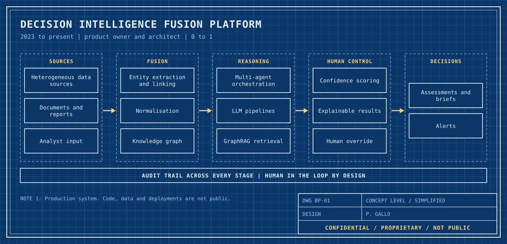
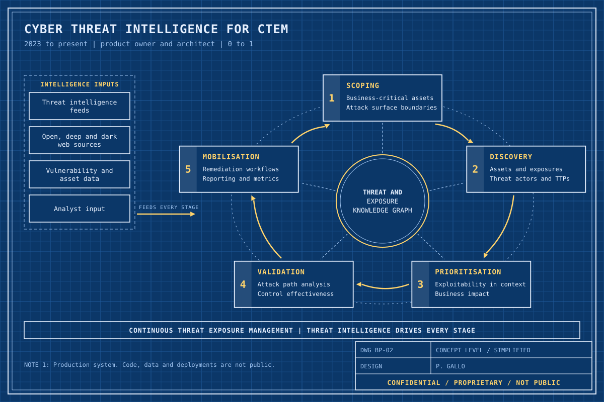
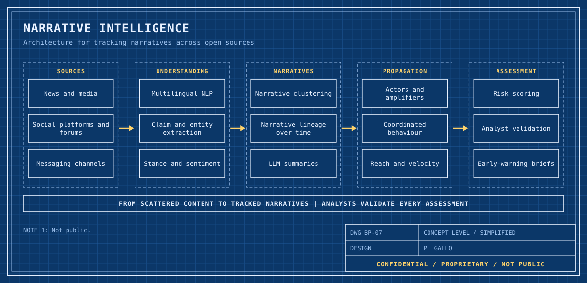
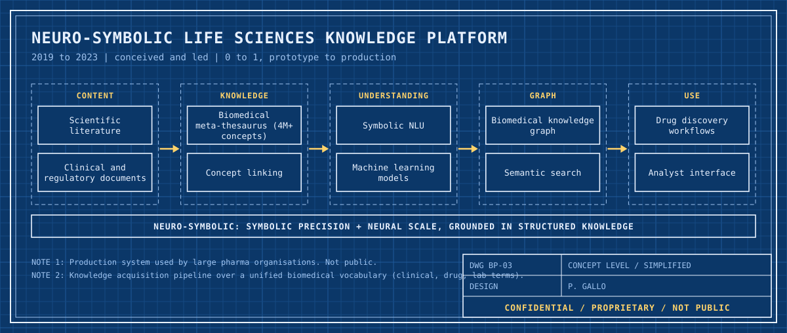
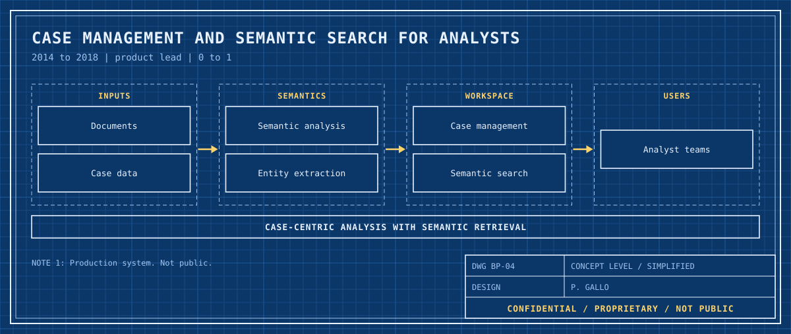
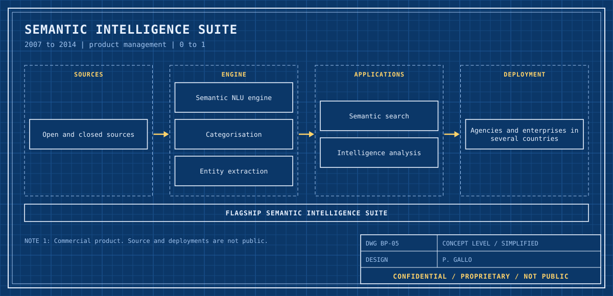
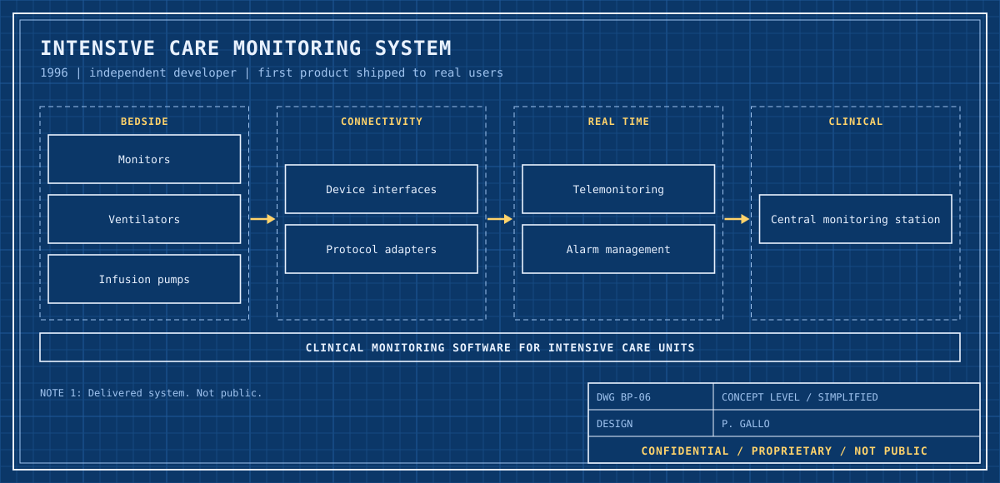

# Paolo Gallo

Head of Decision Intelligence in the intelligence and defence technology sector. 25+ years building AI and data products from zero to production: knowledge graphs, NLP/NLU, multi-agent systems, distributed computing and human-in-the-loop decision support.

The common thread is 0 to 1: six products taken from a blank page to real users, starting with clinical monitoring software for intensive care in 1996.

[LinkedIn](https://www.linkedin.com/in/paologallo/)

## Lab portfolio

The production systems I have built are proprietary. The repositories below are public reference implementations, written in 2026 on synthetic data, that reconstruct the engineering patterns behind that work. Each one builds, runs a demo and has tests in CI.

| Repository | Stack | What it shows |
|---|---|---|
| [decision-model-lab](https://github.com/pgallo/decision-model-lab) | Python | Decision models, DMN-style decision tables, Monte Carlo, value of information, evidence fusion, applied to life sciences, insurance, banking fraud and intelligence analysis |
| [mcp-hitl](https://github.com/pgallo/mcp-hitl) | Python, TypeScript | Twin MCP servers behind one contract and one conformance suite; human approval policy and hash-chained audit trail |
| [kg-rag-lab](https://github.com/pgallo/kg-rag-lab) | Python | Neuro-symbolic retrieval: RDF knowledge graph, entity linking, hybrid graph and vector retrieval, LLM-as-judge evaluation |
| [actor-council](https://github.com/pgallo/actor-council) | Java 21 | Typed actor runtime written from scratch, multi-agent evidence fusion with supervision and human review |
| [blackboard-rmi](https://github.com/pgallo/blackboard-rmi) | Java 21, RMI | Distributed blackboard system: knowledge sources in separate JVMs, opportunistic control |
| [matchmaker-grid](https://github.com/pgallo/matchmaker-grid) | Python | High-throughput computing: declarative resource ads, symmetric matchmaking, fair-share scheduling, DAG workflows |
| [georesolve-cpp](https://github.com/pgallo/georesolve-cpp) | C++17 | Toponym disambiguation with HMM decoding and KNN context models |
| [telemetry-orb](https://github.com/pgallo/telemetry-orb) | C++17, CORBA | Real-time telemonitoring over CORBA with push subscriptions and per-subscriber QoS |
| [bedside-link](https://github.com/pgallo/bedside-link) | Object Pascal | Connectivity gateway for intensive-care equipment: protocol drivers, HL7 v2, alarm engine |
| [fleetline](https://github.com/pgallo/fleetline) | C++17, Python | Fleet telematics: C++ stream engine for geofencing and trips, Python service and analytics via pybind11 |
| [casefile-dotnet](https://github.com/pgallo/casefile-dotnet) | C#, .NET 8 | Case management with a from-scratch BM25 search engine, facets and link analysis |
| [waypoint-android](https://github.com/pgallo/waypoint-android) | Rust, Kotlin | Offline-first Android app with a Rust core shared through UniFFI and CRDT-style sync |

## Capability map

| Capability | Where to look |
|---|---|
| Decision intelligence and decision modelling | decision-model-lab, actor-council |
| Human-in-the-loop AI, explainability, audit | mcp-hitl, actor-council, decision-model-lab |
| LLM pipelines, RAG, GraphRAG, evaluation | kg-rag-lab, mcp-hitl |
| Knowledge graphs, ontologies, semantic search | kg-rag-lab, casefile-dotnet |
| NLP/NLU and classical ML (HMM, KNN, gradient boosting) | georesolve-cpp, decision-model-lab |
| Multi-agent systems and actor model | actor-council, blackboard-rmi |
| Distributed and grid computing (CORBA, RMI, matchmaking) | telemetry-orb, blackboard-rmi, matchmaker-grid |
| Real-time systems and device integration | bedside-link, telemetry-orb, fleetline |
| Geospatial processing | georesolve-cpp, fleetline, waypoint-android |
| Mobile and offline-first sync | waypoint-android |
| APIs and services | casefile-dotnet, fleetline, mcp-hitl |

Languages: Python, C++, Java, C#, TypeScript, Object Pascal, Rust, Kotlin.

## Production systems (confidential)

The systems below are proprietary and not public. The drawings are simplified, concept-level blueprints of my own design work. They contain no code, data, customer names or implementation details.

### Decision intelligence fusion platform (2023 to present)

### Cyber threat intelligence for continuous threat exposure management (2023 to present)

### Narrative intelligence

### Neuro-symbolic life sciences knowledge platform (2019 to 2023)

### Case management and semantic search for analysts (2014 to 2018)

### Semantic intelligence suite (2007 to 2014)

### Intensive care monitoring system (1996)

The drawings are generated by [`tools/blueprint.py`](tools/blueprint.py).
